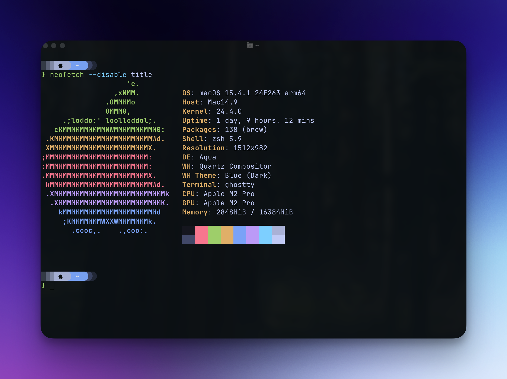

# `~/.dotfiles`

<p align="center">
  
</p>

My personal dotfiles for macOS and GitHub Codespaces environments.

## ✨ Features

- 🔄 Cross-platform setup (macOS & GitHub Codespaces)
- 🧪 GitHub Actions for automated testing
- 🔧 Easy installation with environment detection
- 🛠️ Modular configuration with GNU Stow
- 🎨 Beautiful git diffs with Delta and Rose Pine theme
- 🤖 AI-powered development tools (Claude, Gemini, OpenCode)
- 📊 Modern CLI tools (bat, eza, yazi, btop)

## 🛠️ Tools & Configurations

### 🐚 ZSH

- Custom `.zshrc` configuration
- Various useful aliases and functions
- Integration with tools like `fzf`, `ripgrep`, and more

### 🔮 Neovim

- Full-featured development environment
- LSP integration with autocompletion
- Syntax highlighting and treesitter support
- Snacks for fuzzy finding
- Custom keybindings and plugins
- AI integration with Sidekick
- Cursor like features

### 📊 Tmux

- Custom key bindings
- Status bar customization
- Session management
- Integration with tmux plugins via TPM

### 👻 Ghostty

- Modern terminal emulator configuration
- Custom color schemes and fonts
- Performance optimizations

### 🚀 Starship

- Cross-shell customizable prompt
- Git status integration
- Runtime information

### 🍺 Homebrew

- Package management for macOS
- Customized Brewfile with essential software
- Automated installation of development tools

### 🐳 Docker & Lazydocker

- Custom Docker configuration
- Lazydocker for container management
- OrbStack as the container runtime on macOS
- OrbStack VM settings (CPU/RAM limits) versioned in `orbstack/` and linked to `~/.orbstack/vmconfig.json`
  - Note: OrbStack rewrites this file atomically, so any change made via the GUI or
    `orb config set` replaces the symlink with a regular file. To change a setting,
    edit `orbstack/.orbstack/vmconfig.json` in the repo, run `stow -R orbstack`, and
    restart OrbStack. If you did change it via GUI/CLI, copy the new value into the
    repo and re-run `stow -R orbstack` (delete the regular file first).

### 🗂️ Lazygit

- Terminal UI for Git commands
- Custom keybindings and themes
- Seamless Git workflow
- Integrated with delta for beautiful diffs

### 🎨 Delta

- Enhanced git diff viewer
- Side-by-side diffs with syntax highlighting
- Rose Pine theme integration
- Optimized for lazygit

### 🔄 Mise

- Runtime version manager
- Configuration for multiple languages
- Automatic version switching

### 🦇 Bat

- Modern `cat` replacement with syntax highlighting
- Line numbers and git integration
- Multiple theme support

### 📊 Btop

- Beautiful resource monitor
- System resource visualization
- Process management

### 📁 Eza

- Modern `ls` replacement with colors
- Tree view support
- Git integration

### 🗄️ Yazi

- Terminal file manager
- Fast and efficient navigation
- Preview support for multiple file types

### ⌨️ Karabiner

- Keyboard customization for macOS
- Complex key mappings
- Application-specific shortcuts

### 🤖 AI Tools

- **Claude CLI** - Claude AI integration
- **Gemini CLI** - Google Gemini integration
- **OpenCode** - AI coding assistant with Neovim integration (Toggle sidebar: `Ctrl+x` + `b`)
- **Pi** - AI coding assistant; the session runs `openai/gpt-6.1-sol` with medium reasoning for brainstorming, specs, plans and orchestration, while subagents default to `openai/gpt-6-luna` with medium reasoning for implementation and high reasoning for the reviewer and oracle roles.
  Global instructions live in `pi/.pi/agent/AGENTS.md`: code changes always happen in a Git worktree under
  `~/.worktrees/<repo>/<branch>` via the superpowers `using-git-worktrees` skill, and finished branches are
  pushed and opened as pull requests by `finishing-a-development-branch`.

Reusable skills are owned by the separate `ai-engineering` repository. Pi and OpenCode register
`~/workspace/moisesmorillo/ai-engineering/skills` globally, so updating that repository updates both tools.

| Review | OpenCode | Pi |
| --- | --- | --- |
| Code | `/code-review [scope]` | `/prompt-workflow code-review [scope]` |
| Design | `/design-feasibility-review <document>` | `/prompt-workflow design-feasibility-review <document>` |

These commands launch dedicated subagents on GPT-6.1 Sol with medium reasoning (`openai/gpt-6.1-sol` in
OpenCode, `openai/gpt-6.1-sol` in Pi). Pi's `/skill:...` commands instead load a skill in the
current agent without switching models.

Pi package references in `pi/.pi/agent/settings.json` are intentionally unpinned so Pi can resolve current
releases when packages are installed or updated. The installers merge the repository's Pi settings into
`~/.pi/agent/settings.json`, preserving unrelated settings. Run `scripts/pi-status.sh` to compare declared
package sources for missing or extra entries. Since refs are unpinned, it does not detect whether installed
package versions are current or inspect the package manager's cache.

Model routing by phase lives in `pi/.pi/agent/settings.json`: `defaultModel` (`gpt-6.1-sol`, medium) covers the
session, and `subagents.defaultModel` / `subagents.defaultThinking` (`openai/gpt-6-luna`, medium) cover every
pi-subagents child that does not pin its own model; `subagents.agentOverrides` raises the `reviewer` and `oracle`
roles to high. A one-run benchmark (implementation task with a hidden test suite) showed Luna medium and high
equally correct, with high spending four times the reasoning tokens, so medium is the implementer default. The global `pi/.pi/agent/AGENTS.md` tells the agent which
model to name when a superpowers skill asks for one, so implementers and task reviewers run on Luna and the
final whole-branch review and architecture questions on Sol. The review agents in `pi/.pi/agent/agents/` pin
Sol in their frontmatter and are unaffected by the subagent default.

Installed Pi packages and what each one covers:

| Package | Role |
| --- | --- |
| `pi-subagents`, `pi-background-tasks`, `pi-btw` | Delegation, durable background shell tasks (`/bg`, `bg_run`), side conversations |
| `pi-web-access` | Web search, URL fetching, PDF and video extraction |
| `git:github.com/obra/superpowers` | Process skills: brainstorming, TDD, systematic debugging, worktrees, finishing branches |
| `gentle-engram` | Persistent memory shared across sessions |
| `@narumitw/pi-worktree` | Interactive `/worktree` manager (list, create, switch, remove, prune); root `~/.worktrees` |
| `pi-powerline-footer` | Powerline status bar (model, thinking, git, context %, cost); configured under `powerline` in settings |
| `@juicesharp/rpiv-ask-user-question` | Structured `ask_user_question` tool with typed options |
| `pi-lens` | LSP diagnostics, linters, formatters and type-checking after edits; config in `~/.pi-lens/config.json` and `.pi-lens.json` |
| `cc-safety-net` | Blocks destructive commands (`rm -rf`, force push, `git reset --hard`) and secret-file reads; rules in `.cc-safety-net/` |
| `@pi-unipi/notify` | Native macOS notifications (needs `terminal-notifier` from the Brewfile); config in `~/.unipi/config/notify/config.json` |
| `@plannotator/pi-extension` | Browser-based review of plans, markdown and diffs with annotations sent back to the agent (`/plannotator-annotate`, `/plannotator-review`, `/plannotator-last`); the `plannotator` tool is enabled through the stowed `~/.plannotator/config.json` |

Plannotator is used only as a review surface, never in its plan mode, so it does not compete with the
superpowers planning and execution skills. Repositories opt in through their `AGENTS.md`: after the
`writing-plans` skill saves a plan, the agent opens it with the `plannotator` tool for human annotation, and
before `finishing-a-development-branch` it opens a code review of the branch diff. Feedback arrives as a
later message in the same session. The tool only exists in interactive sessions; agents without it (for
example Claude Code) fall back to presenting the plan and diff in the conversation.

A background task reported as `failed` means its command exited non-zero (for example a failing test
suite); it is not a plugin error. Default tasks are killed on `/reload`, `/new` and resume unless started
with `surviveReload: true`.

Task tracking uses [Backlog.md](https://github.com/MrLesk/Backlog.md) per repository (`backlog init` in the
project), installed through mise (`npm:backlog.md`) and exposed to Pi as the `backlog` MCP server in
`pi/.pi/agent/mcp.json`. Pi's native MCP support is used instead of `pi-mcp-adapter`: since Pi 1.1 MCP tools
are exposed lazily through `codemode`/`deferred`, so the adapter's context savings no longer apply; it would
only add prompts-as-commands, elicitation and keychain OAuth while disabling the built-in client.

We keep the Pi setup lean and do not currently add these optional integrations:

- `@juicesharp/rpiv-todo`: session todo overlay; Backlog.md plus superpowers plans already cover tracking.
- `@narumitw/pi-plan-mode`: enforced read-only planning; superpowers brainstorming covers the workflow.
- `gentle-pi`: a full harness (own subagents, UI and ODD workflow) that would duplicate superpowers and `pi-subagents`.
- `pi-interactive-shell`: useful for interactive long-running commands, but not needed in the current workflow.
- `@tmustier/pi-usage-extension`: adds usage analytics, which are not required here.
- `pi-claude-cli`: not applicable because Pi uses the `openai` provider.

`@juanibiapina/pi-extension-settings` is not installed, so no special package load order is required.

### 🔧 Development Tools

- **Git** - Global git configuration
- **Yamlfmt** - YAML formatter
- **Yamllint** - YAML linter
- **Network Utils** - Network debugging utilities

## 📥 Installation

### macOS

```bash
# Clone the repository
git clone https://github.com/moisesmorillo/dotfiles.git ~/.dotfiles
cd ~/.dotfiles

# Run the install script
chmod +x install.sh
./install.sh
```

### GitHub Codespaces

The dotfiles will be automatically installed when creating a new Codespace.

## 🧪 Testing

This repository includes GitHub Actions workflows to test the configuration:

- Shell script linting with ShellCheck
- YAML validation
- Cross-platform installation tests
- Lua type checking for Neovim configuration

## 📂 Structure

```
.
├── aerospace/    # Window Manager
├── agents/       # AI Agents
├── bat/          # Bat (cat replacement) config
├── borders/      # Borders Config
├── brew/         # Homebrew bundle files
├── btop/         # Btop resource monitor config
├── claude/       # Claude CLI config
├── delta/        # Delta git diff viewer config
├── eza/          # Eza (ls replacement) config
├── gemini/       # Gemini CLI config
├── ghostty/      # Ghostty terminal config
├── karabiner/    # Karabiner keyboard config
├── lazydocker/   # Lazydocker configuration
├── lazygit/      # Lazygit configuration
├── markdownlint/ # Markdown Linting
├── mise/         # Mise runtime manager config
├── network_utils/# Network utilities
├── nvim/         # Neovim configuration
├── opencode/     # OpenCode CLI config
├── scripts/      # Installation scripts
├── starship/     # Starship prompt config
├── tmux/         # Tmux configuration
├── yamlfmt/      # YAML formatter config
├── yamllint/     # YAML linter config
├── yazi/         # Yazi file manager config
└── zsh/          # ZSH configuration
```

## ⚖️ License

MIT 